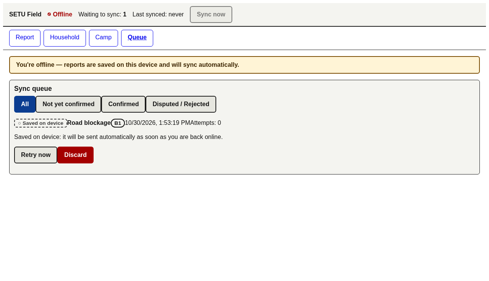
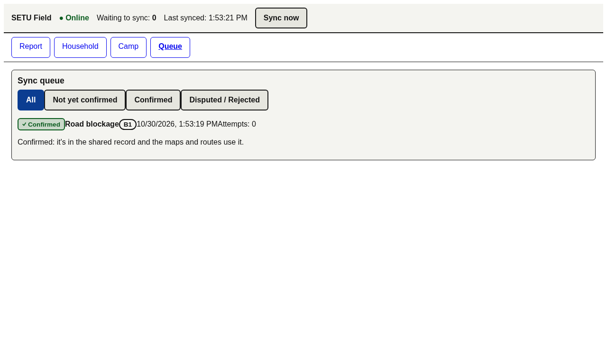
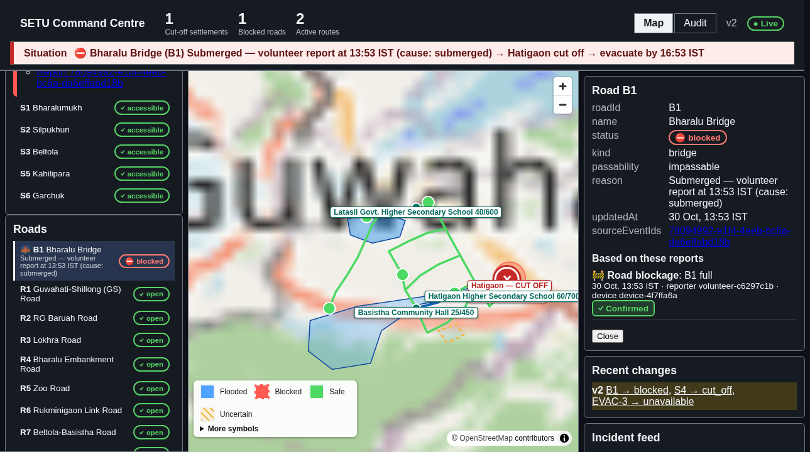
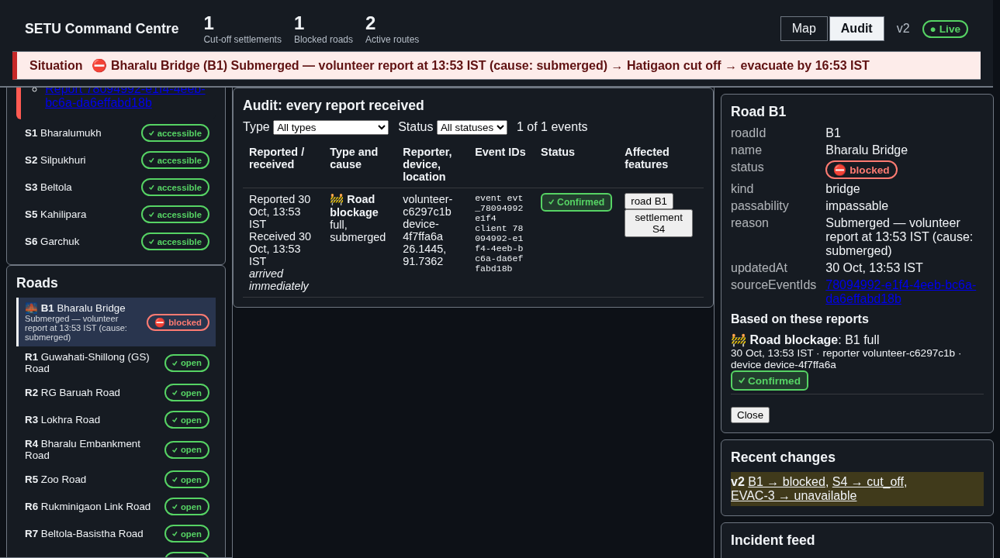

# SETU demo script

A judge-friendly walkthrough. One story: **a volunteer reports a submerged bridge while offline, and the command centre explains who is now cut off, why, and by when they must be evacuated.**

## 0. Start both apps

```sh
cd frontend
npm install
npm run dev -w @setu/field      # http://localhost:5173  (volunteer field app)
npm run dev -w @setu/command    # http://localhost:5174  (command centre)
```

Run each command in its own terminal. Both apps use the mock backend and share state through a small dev relay (port 5199), so a report from the field tab shows up in the command tab. Open the two URLs in two browser tabs side by side.

Reset to the seed scenario at any time with `?mock=off` on the URL, or by restarting the dev servers.

Tip: add `?mock=latency:1500` to the field URL (`http://localhost:5173/?mock=latency:1500`) so the short "Submitted" state stays visible for about 1.5 s. The mock is otherwise too fast to see it. This only slows the mock's responses; the app has no artificial delay.

## 1. Main demo: submerged bridge B1

Status words used everywhere (same colour, icon and text):

| Label | Meaning |
|---|---|
| Saved on device | created while offline; nothing has left the phone |
| Queued for sync | online, waiting to send |
| Submitted | request in flight |
| Accepted — awaiting confirmation | server acknowledged it, but has **not** applied it yet (not synced) |
| Confirmed | server applied it (projection version caught up). Only this means synced |
| Disputed / Rejected | conflict or validation failure; needs a human |
| Retrying | network or server error; will retry |

### Field app (http://localhost:5173)

1. Open the field app. The header shows the online indicator as **Online**.
2. Go offline: browser DevTools → Network → **Offline** (or turn off Wi-Fi). The offline banner appears and the indicator turns **Offline**.
3. Click **Report**, choose **Road blockage**.
4. Road: **Bridge: Bharalu Bridge (B1)**. Blockage: **full**. Cause: **submerged**. Click **Submit**.
5. Open **Queue**. The report shows **Saved on device**. Pending count is 1. (screenshot 1)
6. Go online again (DevTools → **No throttling**). The item moves through **Queued for sync** → **Submitted** → **Accepted — awaiting confirmation** → **Confirmed**. (screenshot 2)





Point out: "Accepted" is deliberately not shown as done. Only **Confirmed** counts.

### Command centre (http://localhost:5174)

7. Switch to the command centre tab. The **situation summary** at the top says in plain language that Bharalu Bridge (B1) is submerged, S4 is cut off, and when to evacuate.
8. In the road list, **B1** is marked as a **bridge**, **impassable** (blocked).
9. In the settlement list, **S4** is **cut off**. Click it: the feature panel shows **Why cut off** (B1 is impassable and no other road reaches S4), the **evacuation deadline** as local time with the time left (e.g. "16:28 IST, in 2h 47m") and **critical** priority.
10. In the route list, **EVAC-3** is **unavailable**. Its **Why this route is refused** block names B1.
11. The feature panel for B1 shows **Based on these reports**: the field report that caused this.
12. The map legend distinguishes **flooded**, **blocked**, **safe** and **uncertain**. The flood area around B1 grew and is marked as observed. A hatched flood area is uncertain.
13. Click **Audit** in the navigation. The audit view lists every event with its client event id and status; the volunteer's report is there. Use the filters to narrow by status.





Optional reversal: in the field app, report **Road cleared** on B1. S4 returns to accessible and the route comes back.

## 2. Camp mode demo (field app)

1. Open **Camp** (`http://localhost:5173/#/camp`).
2. Choose camp **SH1**. The camp info shows its capacity and occupancy from the projections. The choice is remembered on the device.
3. Go offline, register a household in the camp form (name, members, vulnerabilities, needs) and submit. It shows **Saved on device** in the camp household list.
4. Go online: it becomes **Confirmed**.

## 3. Failure demos (field app)

Set the failure mode through the URL. It is saved in the browser; `?mock=off` clears it.

| Demo | URL | What to show |
|---|---|---|
| Conflict | `http://localhost:5173/?mock=conflict` | Block a road that is already cleared. Item shows **Disputed** with a conflict panel: **Keep mine** or **Accept server**. |
| Rejection | `http://localhost:5173/?mock=reject` | Item shows **Rejected**. **Edit** it: the form lists the server's validation errors; fix and resubmit. |
| Server errors | `http://localhost:5173/?mock=5xx:1` | Item shows **Retrying** with growing attempts and backoff. Switch to `?mock=off`: it becomes **Confirmed**. |
| Slow apply | `http://localhost:5173/?mock=delay:8000` | Item sits at **Accepted — awaiting confirmation** for 8 s. Proof that accepted is not synced. |
| Slow network | `http://localhost:5173/?mock=latency:1500` | **Submitted** is visible. |

Also: turn the command centre's browser offline; its connection status switches from **live** to **offline**.

## 4. What is mocked and what is pending the backend

Everything the apps show comes through the `ApiClient` interface. Right now that is an in-process **mock backend** (`@setu/mock-backend`): it is a test double that replays a scripted scenario, not an event engine. The frontend never computes flood extent, routes or accessibility.

| Area | Status |
|---|---|
| Event submission, idempotency by clientEventId, applied-confirmation | mocked; real HTTP adapter waits on the backend ([issue #2](https://github.com/Will-Herondale/The_Iynxs_C-hacks/issues/2)) |
| Planning/architecture and coordination docs | not yet visible to the frontend ([issue #5](https://github.com/Will-Herondale/The_Iynxs_C-hacks/issues/5)) |
| Optional projection fields for this demo (bridge kind, passability, cut-off reason, evacuation deadline, route refusal, flood confidence, blockage cause) | proposed by the frontend, rendered when present, absent-safe ([issue #6](https://github.com/Will-Herondale/The_Iynxs_C-hacks/issues/6)) |
| Real GIS map data | pending ([issue #7](https://github.com/Will-Herondale/The_Iynxs_C-hacks/issues/7)) |

### Data honesty caveat (wave 9)

Routes and ETAs in the demo come from the scenario fixtures, not a router: they are shown as **Route (not verified)** (dashed amber) with ETA "indicative, source unconfirmed". The road graph is fragmented (1,030 components) so no route is a validated evacuation path. All 23 shelters are **Pre-identified · not confirmed** (capacity and occupancy not published). Layers carry REAL / SYNTHETIC / EXPERIMENTAL tags. See `DATA_CLASSIFICATION.md`.

## 5. Automated check

`cd frontend/e2e && npx playwright test` runs the whole story headlessly, including `demo-b1.spec.ts`, which also regenerates the four screenshots in `docs/demo/`.
